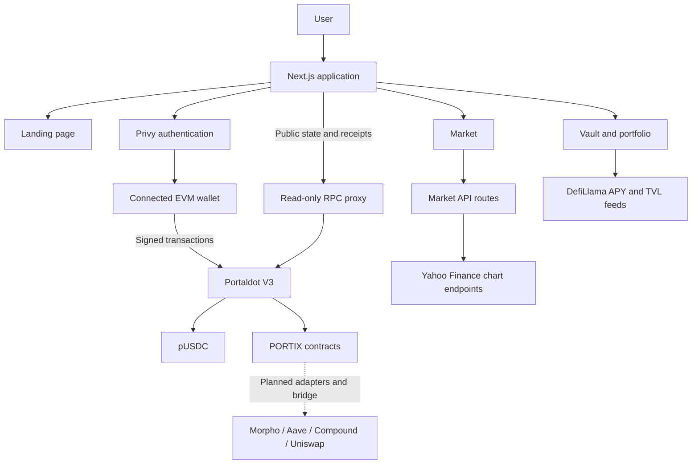

<p align="center">
  
</p>

<h1 align="center">PORTIX</h1>
<p align="center"><strong>Trade tokenized stocks. Put them to work.</strong></p>
<p align="center">A tokenized-equity market and carry-vault application built for Portaldot V3.</p>

## Project Overview

### Problem Statement

Tokenized equities bring stock exposure on-chain, but holding an asset does not automatically make that capital productive. Trading, collateral management, borrowing, and yield strategies often require separate interfaces and multiple transactions. Moving liquidity between chains adds further operational complexity.

PORTIX explores a unified workflow: acquire tokenized stocks, retain equity exposure as collateral, and manage a carry position through a single application.

### Solution

- **Market:** browse AAPL, GOOGL, NFLX, MSFT, META, SPY, QQQ, and NVDA with company identities, price charts, and buy/sell forms.
- **pxPrime:** a lending-carry strategy designed around Morpho, Aave, and Compound.
- **pxBoost:** an AMM-carry strategy designed around Uniswap trading-fee income.
- **Vault workspace:** deposit/withdraw forms, contract previews, strategy information, and interactive seven-day benchmark charts.
- **Portfolio:** wallet holdings, vault positions, and transaction Activity within the Vault route, with clickable Portaldot transaction references.
- **Wallet and faucet:** Privy authentication, external EVM wallet support, and a wallet-signed claim for 5,000 pUSDC.

### Blockchain Relevance

PORTIX uses EVM smart contracts for settlement and position operations on **Portaldot V3**, a testnet based on Substrate's `pallet-revive`. The frontend reads contract state through Viem, requests signatures from the connected wallet, and tracks transaction receipts.

The intended carry workflow borrows pUSDC against stock collateral at an initial **40% LTV**. Cross-chain bridge routing and destination DeFi adapters are part of the architecture; the route visualization does not indicate an active bridge integration.

### Current Release Status

The frontend and wallet/faucet integration are implemented. The published pUSDC and unified `PortixProtocol` deployments have on-chain transaction evidence. However, the current unified contract does not provide the isolated stock/vault accounting expected by the frontend, and withdrawal authorization requires correction. Vault writes remain gated for incompatible deployments.

See [Contract Integration Findings](./CONTRACT_INTEGRATION_FINDINGS.md) for the verified limitations and [Integration Status](./INTEGRATION_STATUS.md) for the implementation handoff. This release should not be described as a completed production DeFi deployment.

## Technical Architecture



### Core Tech Stack

| Component | Technology |
| --- | --- |
| Blockchain platform | Portaldot V3 EVM testnet, chain ID `420420777` |
| Smart contract language | Solidity `0.8.28` |
| Contract development workspace | Foundry |
| Frontend | Next.js 16 App Router, React 19, TypeScript |
| Styling | Tailwind CSS 4 and shared CSS design tokens |
| Wallet authentication | Privy React SDK |
| Contract interaction | Viem |
| Interactive charts | TradingView Lightweight Charts 5 |
| Market display data | Next.js API routes requesting Yahoo Finance chart data |
| DeFi benchmark data | Public DefiLlama yield endpoints |
| Frontend hosting | Vercel-compatible Next.js deployment |

Market display quotes and contract execution prices are separate data sources. The current Market API implementation includes baseline/generated fallbacks when upstream requests fail; polling alone does not guarantee exchange-level real-time data. Vault benchmark APYs represent source protocol observations, not realized PORTIX returns.

### Repository Structure

```text
public/assets/                 Brand artwork, protocol/company logos, background video
src/app/                       Pages and API routes
src/components/shared/         Navbar, buttons, panels, dialogs, charts
src/components/faucet/         Connected-wallet pUSDC faucet
src/features/landing/          Landing experience
src/features/market/           Market UI and chart components
src/features/vault/            Strategy cards, detail forms, portfolio
src/features/wallet/           Privy configuration and wallet/account synchronization
src/lib/portfolio-store.ts     Shared account state and asynchronous actions
src/lib/onchain/               Public deployment manifest, ABIs, contract reads
scripts/                       Manifest synchronization and verification utilities
tests/                         Frontend accounting and data-validation checks
```

## Smart Contracts

### Contract Directory

The local contract integration workspace is `contracts/`, with Solidity sources under `contracts/src/`. **That workspace is excluded from this frontend repository and Vercel uploads.** A fresh clone includes public integration ABIs and addresses in `src/lib/onchain/`, not the Foundry source/deployment workspace.

### Published Contracts

| Contract | Address | Role |
| --- | --- | --- |
| pUSDC | `0x9df05e926a3860a3ccaffa85bb0776c47a9238f4` | Six-decimal settlement asset and public faucet |
| PortixProtocol | `0xb5f071B9e9b159C5Df573678400aB864d0Ec5415` | Current unified stock-trading and carry-operation implementation |

The public manifest currently maps multiple logical roles to the same unified protocol address. These entries do not represent independently deployed stock tokens or isolated vaults.

### Key Contract Interfaces

| Interface / component | Principal functions or responsibilities |
| --- | --- |
| Settlement token | `balanceOf`, `allowance`, `approve`, `faucet` |
| Stock market | `quoteBuy`, `quoteSell`, `buyStockWithExactUSDC`, `sellStock` |
| Carry vault | `previewDepositCarry`, `previewWithdrawCarry`, `depositAndInvest`, `withdrawWithYield` |
| Price oracle | `getPriceUSD`; the current unified implementation returns a fixed testnet price |
| Isolated protocol architecture | Separate stock tokens, debt pool, vault factory, and strategy adapters are present in the local contract workspace; the current unified deployment is not equivalent to that architecture |

### Deployment Instructions

Contract deployment must be performed from the contract owner's reviewed Foundry workspace, using the corrected contracts and their release instructions. This frontend checkout does not provide a standalone contract deployment package.

Once that workspace is available, compile and test it:

```sh
cd contracts
forge build
forge test
```

After the contract owner deploys and verifies a compatible release:

1. Update `contracts/artifacts-for-integration/address-manifest.json` and the matching public ABIs.
2. From the frontend repository root, run `npm run sync:contracts`.
3. Run `npm run verify:onchain` and inspect `docs/onchain-verification.json`.
4. Resolve accounting, authorization, and ABI compatibility failures before enabling Vault writes.

Deployment signing belongs in a separate secure signer/keystore workflow. Never place deployment keys in frontend source, Git, or Vercel environment variables.

## Installation & Setup

### Requirements

- **Node.js 22.x** and npm; see `.nvmrc` and `package.json`.
- A Privy application with Ethereum wallet login enabled.
- An EVM wallet such as Talisman for signed transaction testing.
- tPOT in that wallet to pay Portaldot V3 transaction fees.
- Foundry only if working with the separately supplied contract workspace.

### 1. Clone the Repository

```sh
git clone https://github.com/rikokurnia/portix.git
cd portix
```

### 2. Install Dependencies

```sh
npm ci
cp .env.example .env.local
```

### 3. Configure Privy

Set the public application ID in `.env.local`:

```dotenv
APP_ID_PRIVY=<your-privy-app-id>
```

In the Privy dashboard, enable wallet login and allow the exact local, preview, and production origins used by the application. Talisman must expose an EVM account.

The application does **not** require `APP_SECRET_PRIVY`, `DEPLOYER_PRIVATE_KEY`, seed phrases, or wallet private keys. No additional API key is currently required for the public RPC and Vault benchmark feeds.

### 4. Launch the Frontend

```sh
npm run dev
```

Open the URL printed by Next.js, normally `http://localhost:3000`.

| Route | Experience |
| --- | --- |
| `/` | Landing page |
| `/market` | Stock market |
| `/vault` | Strategy cards and portfolio |
| `/vault/pxPrime` | Lending strategy detail |
| `/vault/pxBoost` | AMM strategy detail |

### 5. Validate and Build

```sh
npm run typecheck
npm run lint
npm test
npm run build
npm start
```

Additional integration checks:

```sh
npm run verify:onchain
npm run check:secrets
```

A successful frontend build does not establish contract security or complete on-chain integration. The verification command reports compatibility separately from code availability.

### Deploy the Frontend on Vercel

| Setting | Value |
| --- | --- |
| Root Directory | Repository root (`.`) |
| Framework Preset | Next.js |
| Node.js | 22.x |
| Install Command | `npm ci` |
| Build Command | `npm run build` |
| Output Directory | Next.js default |
| Required environment variable | `APP_ID_PRIVY` |

Add `APP_ID_PRIVY` to the relevant Production/Preview environments, allow those origins in Privy, and **redeploy**. Do not set the Root Directory to `project` when importing the `rikokurnia/portix` Git repository directly. See [Vercel Environment Setup](./VERCEL_ENV.md).

## Demo

- **Video:** not yet published in this repository.
- **Hosted demo:** deployment URL not yet documented.
- **Local demo:** launch the frontend using the steps above.
- **Test assets:** the connected-wallet faucet requests **5,000 pUSDC**; tPOT is required separately for gas.
- **Test accounts:** use your own testnet EVM wallet. No shared credentials or private keys are distributed.

For the currently supported signed flow, connect a wallet, open Faucet, confirm the claim, and inspect its receipt and portfolio Activity. Full Market-to-Vault testing depends on the corrected contract release described above.

## Roadmap

### Implemented

- PORTIX landing page and shared visual foundation.
- Eight-asset Market interface with interactive charts and API integration.
- pxPrime/pxBoost strategy cards, detail workspaces, and protocol benchmark charts.
- Privy wallet authentication and account selection.
- Connected-wallet pUSDC faucet and receipt-linked Activity.
- Shared portfolio state, exact-decimal inputs, contract previews, and transaction handling.
- Public deployment manifest, ABI integration, and verification utilities.

### Next Phase

- Correct withdrawal authorization and expose readable per-asset/per-strategy share accounting.
- Complete integration against compatible isolated contracts and verify end-to-end wallet flows.
- Remove generated Market fallbacks and strengthen upstream data availability checks.
- Connect and verify destination strategy adapters and cross-chain bridge execution.
- Add indexed account/event history and complete an independent security review.

## License

A project-level license has not yet been specified. This repository currently does not include a `LICENSE` file. Third-party packages and brand assets retain their respective licenses and trademark rights.

## Supporting Documentation

- [Contract Integration Findings](./CONTRACT_INTEGRATION_FINDINGS.md)
- [Frontend Integration Status](./INTEGRATION_STATUS.md)
- [Shared Interface](./SHARED_INTERFACE.md)
- [Privy Integration](./PRIVY_INTEGRATION.md)
- [Vault Asset Sources](./ASSET_SOURCES.md)
- [Market Asset Sources](./ASSET_SOURCES_MARKET.md)
