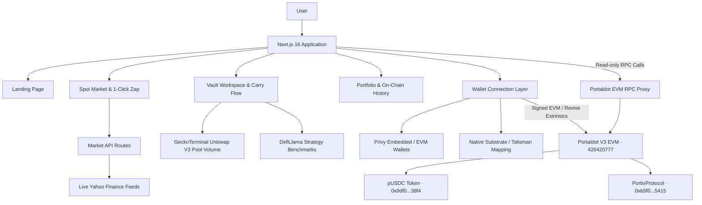

<p align="center">
  
</p>

<h1 align="center">PORTIX</h1>

---

<p align="center">
  <strong>Trade tokenized stocks. Put them to work.</strong><br />
  One-click, automated carry yield strategies backed by tokenized equity collateral.
</p>

<p align="center">
  
  
  
  
  
</p>

<p align="center">
  <a href="https://portiix.vercel.app/"><strong>Open PORTIX</strong></a> &middot;
  <a href="https://youtu.be/w1GCiRtlhwY"><strong>Video Demo</strong></a> &middot;
  <a href="https://scanner-testnet-v3.portaldot.dev/"><strong>Portaldot Scanner</strong></a> &middot;
  <a href="#deployed-smart-contracts"><strong>Contract Addresses</strong></a> &middot;
  <a href="#installation--setup"><strong>Run Locally</strong></a>
</p>

---

## Project Overview

### Problem Statement

Tokenized equities bring real-world stocks on-chain, but once acquired, that capital traditionally sits idle. Holding an asset does not automatically make it productive. To earn yield, manage collateral, or borrow liquidity, users must navigate fragmented exchanges, multiple dApps, and complex multi-step transactions.

PORTIX unifies this journey: acquire tokenized stocks, retain equity exposure as collateral, and deploy automated carry positions through a single non-custodial application.

### Solution

- **Spot Market:** browse and trade AAPL, GOOGL, NFLX, MSFT, META, SPY, QQQ, and NVDA with live TradingView candlestick charts, synchronized real-time price feeds, and spot-only execution rules (no margin, leverage, or naked shorting).
- **1-Click Zap Yield:** convert pUSDC directly into carry yield positions in a single transaction from the Market interface without separate exchange and deposit steps.
- **pxPrime (Lending Carry):** lower-risk carry strategy allocating borrowed liquidity into institutional stablecoin lending benchmarks (Morpho Blue, Aave V3, Compound V3).
- **pxBoost (AMM Carry):** moderate-risk carry strategy capturing trading fees (Uniswap V3 benchmark), backed by live 24h pool volume tracking via GeckoTerminal.
- **Interactive Carry Flow:** animated visual liquidity routing diagram illustrating stock collateral lock, 40% target LTV borrow, and strategy deployment.
- **Vault Workspace & Portfolio:** manage deposits and redemptions, preview on-chain receipts, inspect transparent $1-value unit balances, track time-elapsed projected yields, and view transaction history linked to Portaldot Scanner.
- **Dual Wallet & On-Chain Faucet:** connect via standard EVM wallets (MetaMask, Rabby, Talisman EVM) or native Substrate accounts via deterministic `pallet-revive` mapping, and claim 5,000 testnet pUSDC via wallet-signed transaction.

### Blockchain Relevance & On-Chain Proof

PORTIX operates on **Portaldot V3** (EVM Testnet, Chain ID `420420777`), leveraging Substrate's next-generation smart contract engine (`pallet-revive`).

- **EVM JSON-RPC:** `https://test-evm-rpc-v3.portaldot.dev`
- **Substrate Node:** `wss://test-node-v3.portaldot.dev` (Genesis: `0xd4f9acb...55283bd`)
- **Block Explorer:** [Portaldot Scanner](https://scanner-testnet-v3.portaldot.dev/)

#### Deployed Smart Contracts
| Contract | Address | Block | Role |
| --- | --- | --- | --- |
| **pUSDC Token** | [`0x9df05e926a3860a3ccaffa85bb0776c47a9238f4`](https://scanner-testnet-v3.portaldot.dev/address/0x9df05e926a3860a3ccaffa85bb0776c47a9238f4) | `313,660` | Six-decimal settlement token and public faucet |
| **PortixProtocol** | [`0xb5f071B9e9b159C5Df573678400aB864d0Ec5415`](https://scanner-testnet-v3.portaldot.dev/address/0xb5f071B9e9b159C5Df573678400aB864d0Ec5415) | `314,291` | Unified stock market, collateral locking, and carry vault engine |

#### Confirmed On-Chain Lifecycle Receipts
Every user action produces verifiable transactions on the Portaldot V3 testnet:
- **Faucet Claim:** [`0x3ca2a9730f11615e50b1221b4b835a9f727601f49a72ebb2d7fa6a1c76cc0fbc`](https://scanner-testnet-v3.portaldot.dev/tx/0x3ca2a9730f11615e50b1221b4b835a9f727601f49a72ebb2d7fa6a1c76cc0fbc) (Block 313,665)
- **Token Approval:** [`0xa5ca471ad3a06dbb03892f78372975a7e7777be5c6428899ecc016587ad3aed9`](https://scanner-testnet-v3.portaldot.dev/tx/0xa5ca471ad3a06dbb03892f78372975a7e7777be5c6428899ecc016587ad3aed9) (Block 314,307)
- **Buy Stock Collateral:** [`0x0b8891f8e964cbae36ca37e1fad29083897d7268d1023866a5e26eeb9400470c`](https://scanner-testnet-v3.portaldot.dev/tx/0x0b8891f8e964cbae36ca37e1fad29083897d7268d1023866a5e26eeb9400470c) (Block 314,308)
- **Deposit to Carry Vault:** [`0x17246f8a431da4d18d874e27d114b9d4c155836f10a928025643ab9c3f24a8f7`](https://scanner-testnet-v3.portaldot.dev/tx/0x17246f8a431da4d18d874e27d114b9d4c155836f10a928025643ab9c3f24a8f7) (Block 314,312)
- **Withdraw with Yield:** [`0x1e62d6475ef28d627b237f1268e2e7aebfbbecf058a205682e20dcdb45d5cc55`](https://scanner-testnet-v3.portaldot.dev/tx/0x1e62d6475ef28d627b237f1268e2e7aebfbbecf058a205682e20dcdb45d5cc55) (Block 314,316)
- **Spot Sell Stock:** [`0x10d6990001e8c312ae6adba5a33b5137c8ec6ee749888975d7bb354e6595882a`](https://scanner-testnet-v3.portaldot.dev/tx/0x10d6990001e8c312ae6adba5a33b5137c8ec6ee749888975d7bb354e6595882a) (Block 314,319)

---

## Technical Architecture



### Core Tech Stack

| Component | Technology | Description |
| --- | --- | --- |
| **Blockchain Platform** | Portaldot V3 EVM Testnet | Substrate `pallet-revive` engine, chain ID `420420777` |
| **Smart Contracts** | Solidity `0.8.28` | Tested with Foundry, compiled with Cancun EVM target |
| **Frontend Framework** | Next.js 16 App Router | React 19, TypeScript, Server Components |
| **Styling** | Tailwind CSS 4 & Custom CSS | Custom institutional dark design tokens |
| **Contract Interaction** | Viem & @polkadot/api | Dual EVM and Substrate extrinsic submission |
| **Wallet Authentication** | Privy SDK & Native Wallet | Embedded wallets, MetaMask, Rabby, Talisman |
| **Interactive Charts** | TradingView Lightweight Charts 5 | Real-time equity candles and volume indicators |
| **Market Feeds** | Yahoo Finance & GeckoTerminal | Real-time equity quotes and live 24h pool volume |
| **Deployment** | Vercel | Production edge hosting |

### Repository Structure

```text
contracts/                     Solidity smart contracts, Foundry tests, and deployment scripts
  ├── src/                     Core contracts (PortixProtocol, DebtPool, StockMarket, Oracle, Vaults)
  ├── test/                    Foundry test suites (unit, fuzz, invariant, regression)
  └── script/                  Preflight verification and deployment scripts
public/assets/                 Brand artwork, stock icons, protocol logos, video assets
src/app/                       Next.js pages (Landing, Market, Vault, Testnet redirect) and API routes
src/components/shared/         Navbar, modal, buttons, panels, charts, transaction links
src/components/faucet/         Connected-wallet 5,000 pUSDC faucet
src/features/landing/          Landing hero, walkthrough, and interactive showcases
src/features/market/           Market board, TradingView charts, trade forms, 1-Click Zap modal
src/features/vault/            Carry strategy cards, detail forms, animated carry flow, portfolio
src/features/wallet/           Privy provider, native Substrate client, address derivation
src/lib/portfolio-store.ts     Shared non-custodial account store, quotes, and on-chain dispatchers
src/lib/onchain/               Contract ABIs, addresses manifest, and RPC policy
scripts/check-secrets.mjs      Automated zero-secret pre-commit scanner
tests/                         9 automated test suites covering accounting, safety, and feeds
```

---

## Smart Contracts

The smart contracts are located in `contracts/`, fully tracked and tested using Foundry.

### Core Contracts & Roles

| Contract | Source File | Description |
| --- | --- | --- |
| **PortixProtocol** | `contracts/src/PortixProtocol.sol` | Unified protocol orchestrating spot trading, debt accounting, and carry vaults |
| **PortixStockToken** | `contracts/src/PortixStockToken.sol` | ERC-20 tokenized equity representation (18 decimals) |
| **PortixDebtPool** | `contracts/src/lending/PortixDebtPool.sol` | Liquidity borrowing credit facility targeting 40% initial LTV |
| **StockMarket** | `contracts/src/market/StockMarket.sol` | Spot trading market with precise 10 bps fee accounting |
| **PortixPriceOracle** | `contracts/src/oracle/PortixPriceOracle.sol` | Valuation oracle with bounds checking and circuit breakers |
| **PortixVault** | `contracts/src/vaults/PortixVault.sol` | ERC-4626 carry vault with automated debt discharge on redemption |
| **Strategy Adapters** | `contracts/src/strategies/` | MockLendingStrategyAdapter (pxPrime) and MockAmmStrategyAdapter (pxBoost) |

### Key Contract Interfaces

| Interface / Component | Key Functions |
| --- | --- |
| **Settlement Token (pUSDC)** | `balanceOf`, `allowance`, `approve`, `faucet` |
| **Stock Market** | `quoteBuy`, `quoteSell`, `buyStockWithExactUSDC`, `sellStock` |
| **Carry Vault** | `previewDepositCarry`, `previewWithdrawCarry`, `depositAndInvest`, `withdrawWithYield` |
| **Oracle & Valuation** | `getPriceUSD`, `getVaultMetrics`, `getVaultShares` |

### Testing & Verification

The protocol includes rigorous test suites across both smart contracts and frontend integration:

1. **Foundry Smart Contract Tests** (6 test suites):
   ```sh
   cd contracts
   forge test
   ```
   Passes all 31+ unit and fuzz tests covering spot trading, auto-borrowing at 40% LTV, strategy gain settlement, price shock handling, and donation attack resistance.

2. **Frontend & Integration Tests** (9 test suites):
   ```sh
   npm test
   ```
   - `portfolio.test.ts`: wallet isolation and action guards.
   - `market.test.ts`: fee arithmetic, decimals, and OHLC data.
   - `vault-market-data.test.ts`: APY/TVL benchmarking and GeckoTerminal volume parsing.
   - `transaction-safety.test.ts`: RPC policies and signature enforcement.
   - `market-api.test.ts`: upstream price resilience and ticker handling.
   - `wallet-funding.test.ts`: chain-verified SS58/EVM address derivation and decimal scaling.
   - `native-wallet.test.ts`: Substrate genesis, revive calls, and interface proofs.
   - `vault-process.test.ts`: state transitions, approval flow, and receipt tracking.
   - `vault-accounting.test.ts`: $1 value unit conversion, exact shares, and proportional redemptions.

3. **Zero-Secret Security Scan**:
   ```sh
   npm run check:secrets
   ```
   Audits 3,560+ source and build files before every commit, ensuring 0 private keys or signing materials are ever exposed.

---

## Installation & Setup

### Requirements

- **Node.js 22.x** and npm (see `.nvmrc`).
- A modern EVM wallet (MetaMask, Rabby, or Talisman) with Portaldot V3 EVM testnet added.
- Testnet tPOT for transaction gas fees.
- Foundry (optional, for contract development/testing).

### 1. Clone the Repository

```sh
git clone https://github.com/rikokurnia/portix.git
cd portix
```

### 2. Install Dependencies

```sh
npm ci
cp .env.example .env.local
```

### 3. Configure Environment

Set your Privy application ID in `.env.local`:

```dotenv
APP_ID_PRIVY=<your-privy-app-id>
```

> [!NOTE]
> The application does **not** require private keys, deployer secrets, or paid API keys. Public RPC and market feeds are preconfigured.

### 4. Launch Development Server

```sh
npm run dev
```

Open `http://localhost:3000` in your browser.

| Route | Description |
| --- | --- |
| `/` | Landing page and protocol overview |
| `/market` | Spot stock market, live charts, and 1-Click Zap |
| `/vault` | Strategy vaults, interactive carry flow, and portfolio activity |
| `/vault/pxPrime` | Lending carry strategy detail |
| `/vault/pxBoost` | AMM trading fee strategy detail |

### 5. Validate and Build

```sh
npm run typecheck
npm run lint
npm test
npm run check:secrets
npm run build
```

---

## Live Demo & Verified Links

- **Live Application:** [https://portiix.vercel.app/](https://portiix.vercel.app/)
- **GitHub Repository:** [https://github.com/rikokurnia/portix/](https://github.com/rikokurnia/portix/)
- **Video Walkthrough:** [https://youtu.be/w1GCiRtlhwY](https://youtu.be/w1GCiRtlhwY)
- **Portaldot Block Scanner:** [https://scanner-testnet-v3.portaldot.dev/](https://scanner-testnet-v3.portaldot.dev/)
- **Settlement Token (pUSDC):** [`0x9df05e926a3860a3ccaffa85bb0776c47a9238f4`](https://scanner-testnet-v3.portaldot.dev/address/0x9df05e926a3860a3ccaffa85bb0776c47a9238f4)
- **Protocol Contract:** [`0xb5f071B9e9b159C5Df573678400aB864d0Ec5415`](https://scanner-testnet-v3.portaldot.dev/address/0xb5f071B9e9b159C5Df573678400aB864d0Ec5415)

---

## Supporting Documentation

- [Contract Integration Findings](./CONTRACT_INTEGRATION_FINDINGS.md)
- [Frontend Integration Status](./INTEGRATION_STATUS.md)
- [Smart Contracts Architecture](./contracts/ARCHITECTURE.md)
- [Smart Contracts README](./contracts/README.md)
- [Shared Interface](./SHARED_INTERFACE.md)
- [Privy Integration](./PRIVY_INTEGRATION.md)
- [Vault Asset Sources](./ASSET_SOURCES.md)
- [Market Asset Sources](./ASSET_SOURCES_MARKET.md)
